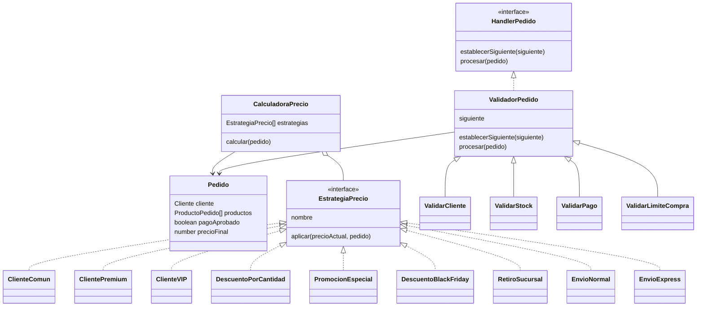

# Trabajo Practico - Patrones de Diseño

Este proyecto resuelve el trabajo practico usando dos patrones:

- **Strategy**, para calcular el precio final aplicando varias reglas independientes.
- **Chain of Responsibility**, para validar un pedido paso a paso.

## Como ejecutar

Desde esta carpeta:

```bash
npm start
```

Para abrir la experiencia clickeable en el navegador:

```bash
npm run web
```

Luego abrir:

```text
http://localhost:4321
```

## Para que sirve cada archivo

### Archivos principales

- `package.json`: define el comando `npm start`.
- `src/main.ts`: crea los pedidos de prueba, aplica las estrategias y ejecuta la cadena de validacion.
- `src/modelos.ts`: contiene las estructuras principales: `ProductoPedido`, `Cliente`, `Pedido` y funciones para calcular subtotal y cantidad.
- `src/utils/moneda.ts`: formatea los precios para mostrarlos como moneda.
- `web/index.html`: pantalla visual para recorrer el trabajo paso a paso.
- `web/styles.css`: estilos del frontend.
- `web/app.js`: logica interactiva del frontend.
- `server.ts`: servidor local para abrir el frontend.

### Parte 1 - Strategy

- `src/strategy/EstrategiaPrecio.ts`: interfaz que deben cumplir todas las estrategias de precio.
- `src/strategy/CalculadoraPrecio.ts`: recibe una lista de estrategias y las aplica una por una.
- `src/strategy/ClienteComun.ts`: estrategia sin descuento.
- `src/strategy/ClientePremium.ts`: aplica 10% de descuento.
- `src/strategy/ClienteVIP.ts`: aplica 15% de descuento.
- `src/strategy/DescuentoPorCantidad.ts`: aplica 5% si hay mas de 5 productos o 10% si hay mas de 10.
- `src/strategy/PromocionEspecial.ts`: permite crear una promocion con el porcentaje que se necesite.
- `src/strategy/DescuentoBlackFriday.ts`: desafio, agrega un descuento nuevo sin tocar las estrategias anteriores.
- `src/strategy/RetiroSucursal.ts`: envio gratis.
- `src/strategy/EnvioNormal.ts`: suma $5.000.
- `src/strategy/EnvioExpress.ts`: suma $10.000.

### Parte 2 - Chain of Responsibility

- `src/chain/HandlerPedido.ts`: interfaz que deben cumplir todos los validadores.
- `src/chain/ResultadoValidacion.ts`: estructura del resultado de cada validacion.
- `src/chain/ValidadorPedido.ts`: clase base que maneja el paso al siguiente validador.
- `src/chain/ValidarCliente.ts`: verifica que el cliente este activo.
- `src/chain/ValidarStock.ts`: verifica que haya stock suficiente.
- `src/chain/ValidarPago.ts`: verifica que el pago haya sido aprobado.
- `src/chain/ValidarLimiteCompra.ts`: desafio, agrega un nuevo control sin modificar los validadores anteriores.

## Diagrama de clases



## Explicacion breve

### ¿Que problema resuelve Strategy?

Strategy permite que cada regla de precio este separada en una clase distinta. Asi se puede cambiar, agregar o quitar una regla sin modificar las otras.

### ¿Por que una compra puede necesitar varias estrategias?

Porque el precio final puede depender de varias condiciones al mismo tiempo. Por ejemplo, un cliente VIP puede tener descuento por tipo de cliente, descuento por cantidad, una promocion especial y ademas un costo de envio.

### ¿Que problema resuelve Chain of Responsibility?

Chain of Responsibility permite procesar un pedido por varios controles ordenados. Cada validador revisa una sola cosa y decide si el pedido continua o se rechaza.

### ¿Que sucede cuando un elemento de la cadena rechaza el pedido?

El procesamiento se detiene en ese punto. Los validadores siguientes no se ejecutan y se informa el motivo del rechazo.

## Casos incluidos

- Pedido aprobado.
- Pedido rechazado por falta de stock.
- Pedido rechazado por problema en el pago.

## Desafio

Se agregaron dos elementos nuevos sin modificar las clases existentes:

- `DescuentoBlackFriday`, como nueva estrategia.
- `ValidarLimiteCompra`, como nuevo validador de la cadena.
